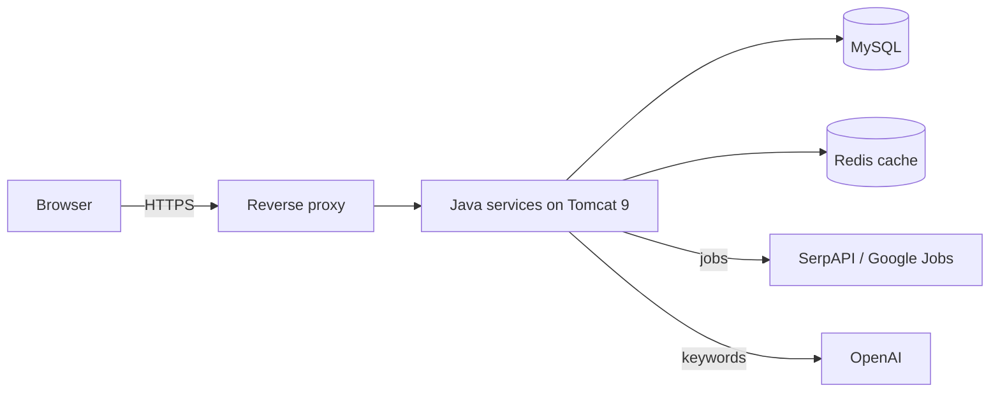

# Job Recommendation System

A job-search web app that recommends jobs from your favorites: **Java** RESTful services, **OpenAI** keyword extraction, **TF-IDF** profiling blended with **Google Jobs** for geo-aware retrieval, a **MySQL** data layer with composite indexes, **Redis** cache-aside, and a **Docker / Kubernetes / Jenkins** delivery setup.
The source code is private (see [Scope](#scope)).

**Live demo:** https://32-199-90-119.sslip.io/ (register with any username of lowercase letters, digits and underscores; favorite a few jobs, then open **Recommended**)

> Please don't reuse a real password on the demo. If the monthly search budget or the jobs API is unavailable, the demo serves jobs clearly labelled **"SAMPLE LISTING (demo fallback)"**.

## How it works

1. Search for jobs near you (Google Jobs results via SerpAPI; your location is turned into a city name).
2. Favorite the ones you like.
3. **Recommended** builds a TF-IDF profile from your favorites, searches for its most characteristic terms, and ranks the candidates by cosine similarity. Job keywords are extracted with OpenAI.

## Measurements

All numbers were measured on my own machine (Docker Desktop, seeded synthetic data) and show mechanisms and orders of magnitude, not production capacity.

### Database, connection pooling, indexes and cache
Seeded dataset: 20,000 jobs, ~118k keyword rows, 200 users. I counted what reached MySQL with its own counters, not just client-side timings.

| Setup (read-only workload, 8 concurrent clients) | SELECTs per request | Throughput |
|---|---|---|
| Original data access (new connection per request, N+1 queries) | ~5 | 81–126 req/s |
| Connection pool + batched queries + composite index | 2.3 | ~310 req/s |
| + Redis cache-aside (warm) | 0 | 470–800 req/s |

- A keyword lookup went from a 118k-row index scan to a 493-row range scan: **33.8 ms → 0.145 ms** (`EXPLAIN ANALYZE`).
- With 10% writes and a cold cache, the cache cut rows read per request from ~31,000 to ~250; p95 latency barely moved (71.5 → 70.8 ms) because the slowest requests are the cache misses.
- Single machine for load and database; the contribution of each change (pool, batching, index) was not measured separately.

### Containers, health probes, rolling updates and autoscaling
Multi-stage, non-root Docker image; Kubernetes manifests with startup / readiness / liveness probes (liveness deliberately does not check the database), rolling updates, a horizontal pod autoscaler and a disruption budget. A Jenkins pipeline definition (test → build image → deploy → verify rollout → undo on failure) is included in the code. Experiments ran on a local single-node cluster:

| Experiment (360 requests to the app during the event) | Result |
|---|---|
| Rolling update 1.0.1 → 1.0.2 under traffic | 0 failed requests; traffic shifted between versions |
| Deliberately broken release, then rollback | New pod never received traffic; 0 failed requests; undo took seconds |
| Database stopped | App pods marked not-ready (not restarted); recovered on their own |
| Autoscaler under synthetic load | 2 → 6 pods in ~15 s, back to 2 after the load ended |

Light synthetic load on one node: this verifies the behavior, not a capacity gain.

### External APIs and deduplicated calls
Search results are cached for 6 hours by (query, location); each job's OpenAI keywords are cached for 7 days; OpenAI is called once per page of jobs (not once per job) with schema-enforced output; real SerpAPI calls are capped per month.
A repeated recommendation went from **~20.7 s cold to ~50 ms with zero external calls**. The first real run cost **$0.0032** in OpenAI usage (~17k tokens).

## Scope

The project extends a provided starter codebase (basic web UI and servlet skeleton). I don't have clearance to publish it, which is why the code is private. I'm happy to walk through it live.
The TF-IDF recommender, the pooled/batched data layer and indexes, the Redis cache, the benchmark harness, the external-API layer, and the Docker/Kubernetes setup are my additions.

## Tech

Java 17, servlets on Tomcat 9, MySQL 8, Redis 7, HikariCP, Jackson, Docker, Docker Compose, Kubernetes, Jenkins, JUnit 5, Python (benchmarks), OpenAI API, SerpAPI.
